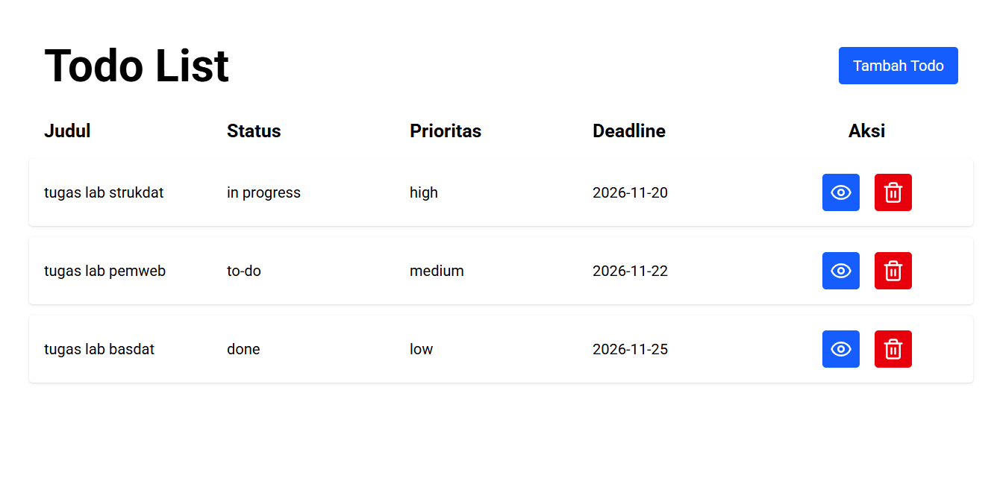
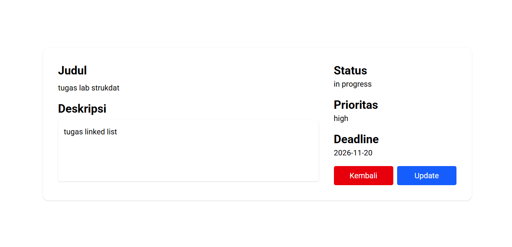
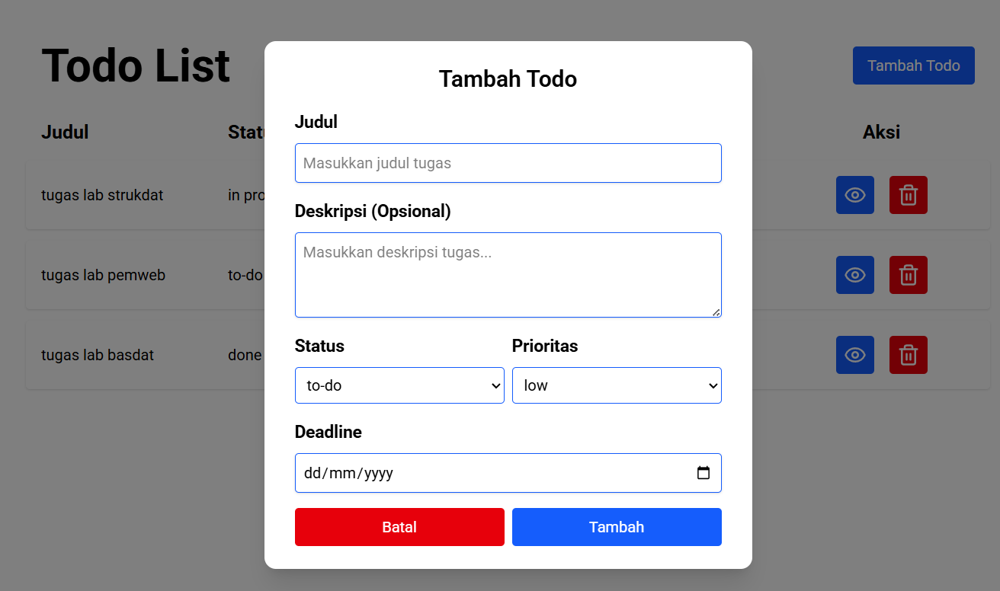

# To-Do List App

## Deskripsi

To-Do List App adalah aplikasi sederhana berbasis React.js yang digunakan untuk membantu pengguna mengelola daftar tugas.

Aplikasi ini dibuat sebagai tugas praktik Pengembangan Frontend. Pengguna dapat menambahkan, melihat, mengedit, dan menghapus tugas.

Data aplikasi menggunakan dummy data yang dikelola melalui React State dan Context API tanpa menggunakan backend maupun API.

## Fitur

- Menampilkan daftar tugas
- Menambahkan tugas baru
- Melihat detail tugas
- Mengedit tugas
- Menghapus tugas
- Mengatur status tugas
- Mengatur prioritas tugas
- Menentukan deadline
- Deskripsi tugas bersifat opsional

## Teknologi

- React.js
- JavaScript
- Vite
- Tailwind CSS
- React Router
- Lucide React
- Context API

## Struktur Folder

src
- components
    - AddTodoModal.jsx
    - ConfirmDeleteModal.jsx
    - TodoCard.jsx
- context
    - TodoContext.jsx
- pages
    - HomePage.jsx
    - TodoDetailPage.jsx
    - NotFoundPage.jsx
- App.jsx
- index.css
- main.jsx

screenshots
- detail.png
- form-todo.png
- homepage.png


## Cara Menjalankan

1. Clone repository:

   ```bash
   git clone https://github.com/aza-aja/Pengembangan_Frontend_To-Do_List_dengan_React.js.git
   ```

2. Masuk ke folder project:

   ```bash
   cd Pengembangan_Frontend_To-Do_List_dengan_React.js
   ```

3. Install dependencies:

   ```bash
   npm install
   ```

4. Jalankan aplikasi:

   ```bash
   npm run dev
   ```

## Screenshot

### Halaman Utama



### Detail Tugas



### Form Tambah Tugas



## Catatan

- Menggunakan data dummy.
- Data dikelola menggunakan React State dan Context API.
- Data tidak tersimpan secara permanen setelah halaman di-refresh.
- Tidak menggunakan backend maupun API.

## Repository

[GitHub Repository](https://github.com/aza-aja/Pengembangan_Frontend_To-Do_List_dengan_React.js)